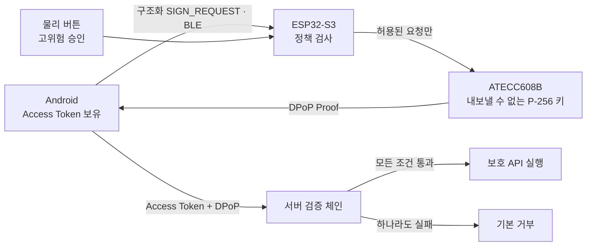

<p align="center">
  <a href="#introduction">
    
  </a>
</p>
<p align="center">
  <br />
  <a href="#introduction"><strong>Introduction</strong></a> ·
  <a href="#threat-model"><strong>Threat Model</strong></a> ·
  <a href="#architecture"><strong>Architecture</strong></a> ·
  <a href="#validation"><strong>Validation</strong></a>
</p>

<p align="center">
  
  
  
  
</p>

## Introduction

TALOS는 로그인 이후 탈취된 Access Token이 다른 기기에서 재사용되는 문제를 다루는 하드웨어 결합 세션 인증 시스템입니다. RFC 9449 DPoP의 소유 증명 구조를 바탕으로 Android, BLE, ESP32-S3, ATECC608B Secure Element와 서버 검증을 하나의 요청 경로로 연결했습니다.

개인키를 안전하게 보관하는 데서 그치지 않고, **어떤 요청에 서명을 허용할 것인지**까지 모바일 앱 밖의 독립 인증기가 판단합니다. 토큰, 키, 요청 내용, 신선도, 위험도, 사용자 승인을 하나의 검증 체인으로 묶어 탈취된 토큰만으로는 보호 API를 실행할 수 없도록 설계했습니다.

## Threat Model

### 보호 대상

- 탈취한 Access Token을 다른 기기에서 재사용하는 공격
- 침해된 모바일 소프트웨어가 사용자 승인 없이 고위험 요청 서명을 얻는 상황
- DPoP 증명 재사용과 다른 키를 이용한 증명
- HTTP method, URI, token, 요청 본문 치환
- 만료된 증명과 중복 `jti`
- 세션 갱신 경로에서 탈취한 refresh token 재사용

### 범위 밖

- Secure Element를 물리적으로 분해하는 침습 공격
- 전력·전자기 기반 부채널 공격

이 범위 구분은 구현상의 누락이 아니라 이번 탐구에서 검증할 공격 조건을 명확히 하기 위한 위협 모델의 경계입니다.

## Architecture



Android는 Access Token을 보유하지만 서명 개인키는 보유하지 않습니다. ESP32-S3 펌웨어가 요청의 의미와 위험도를 검사하고, 허용된 요청만 ATECC608B 내부의 내보낼 수 없는 P-256 개인키로 서명합니다.

Secure Element 또는 펌웨어가 실패했을 때 소프트웨어 키로 우회하는 대체 경로는 두지 않습니다.

## Hardware Policy Boundary

ESP32-S3는 Android가 전달한 임의의 해시를 그대로 서명하지 않습니다. `SIGN_REQUEST`의 각 필드를 독립적으로 해석하고 정책을 통과한 요청만 한 번 서명합니다.

| 필드 | 목적 |
| --- | --- |
| `version` | 프로토콜 버전 확인 |
| `request_id` | 승인과 요청을 결합하고 중복 사용 방지 |
| `method` · `path` | 서명 대상을 특정 HTTP 요청에 결합 |
| `ath` | Access Token 해시 결합 |
| `nonce` | 서버가 요구한 신선도 증명 |
| `issued_at` · `expires_at` | 유효시간 검증 |
| 위험 등급 | 자동 증명 또는 물리 승인 정책 선택 |
| 요청 본문 해시 | 고위험 요청의 실제 내용 결합 |

고위험 요청은 물리 버튼 승인을 요구합니다. 승인 상태는 `request_id`와 만료시간에 묶이며 한 번 사용하면 즉시 소모됩니다. 버튼을 먼저 눌렀지만 유효한 요청이 없거나 승인 시간이 지난 경우에는 서명을 허용하지 않습니다.

저위험 조회는 자동 증명을 허용해 모든 요청에 물리 승인을 강제하는 사용성 비용을 피합니다.

## Server Verification

서버는 다음 검증을 순서대로 수행합니다.


1. **토큰 유효성** — Access Token이 유효한지 확인합니다.
2. **키 소유** — 증명에 사용한 공개키 지문이 토큰의 `cnf.jkt`와 일치하는지 확인합니다.
3. **요청 결합** — `htm`, `htu`, `ath`와 고위험 요청의 `rqh`가 실제 요청과 일치하는지 검사합니다.
4. **신선도와 재사용 방지** — `nonce`, `iat`, `jti`를 검사해 오래되었거나 이미 사용된 증명을 거부합니다.
5. **정책 실행** — scope와 위험 정책까지 통과한 요청만 실행합니다.

표준 DPoP가 자동으로 보호하지 않는 애플리케이션 요청 본문은 정규화 후 해시한 `rqh`로 결합했습니다. refresh token에도 같은 키 소유 증명을 요구해 세션 갱신 경로가 별도의 Bearer 자격증명으로 남지 않도록 했습니다.

## Validation

| 검증 | 규모 | 결과 |
| --- | ---: | ---: |
| 프로토콜 공격 시뮬레이션 | 10개 유형 × 10,000회 | 100,000 / 100,000 차단 |
| 실물 토큰 재사용 공격 | 50회 | 50 / 50 차단 |
| 실물 무승인 고위험 요청 | 30회 | 30 / 30 차단 |
| 외부 인증기 추가 지연 | 종단간 측정 | 중앙값 143 ms |

프로토콜 공격 시뮬레이션에는 토큰 재사용, 다른 키 사용, 증명 재사용, method·URI·token 치환, 만료된 증명, 무승인 고위험 요청, 승인 뒤 본문 변조, 갱신 토큰 탈취 등이 포함됩니다.

실물 검증은 다음 경로를 하나로 연결해 수행했습니다.

```text
Android → BLE → ESP32-S3 → ATECC608B → 서버
```

보안 차단률뿐 아니라 독립 하드웨어 경계를 추가하면서 발생하는 정상 요청의 지연도 함께 측정했습니다.

## Security Properties

| 속성 | 구현 방식 |
| --- | --- |
| 키 비밀성 | P-256 개인키를 ATECC608B 밖으로 내보내지 않음 |
| 키 사용 통제 | ESP32-S3가 요청 의미와 위험 정책을 검사 |
| 요청 결합 | method·URI·token hash·본문 hash를 증명에 포함 |
| 재사용 방지 | nonce·iat·jti·request_id 검증 |
| 사용자 의도 | 고위험 요청에 일회성 물리 승인 요구 |
| 실패 시 안전 | 소프트웨어 키 대체 없이 기본 거부 |
| 갱신 경로 보호 | refresh token에도 동일한 키 소유 증명 요구 |

## Technical Scope

TALOS는 토큰을 안전하게 저장하는 장치가 아니라, **세션 사용 권한을 개인키·요청 내용·신선도·사용자 승인에 결합하는 인증 구조**입니다. 이번 검증은 탈취 토큰의 재사용과 사용자 모르게 얻는 고위험 서명을 실제 하드웨어 경계에서 차단하는 데 초점을 맞췄습니다.

이 README는 연구 포트폴리오 자료의 설계와 측정 결과를 기준으로 정리했습니다. 공개 펌웨어, Android 클라이언트와 서버 코드가 연결되면 빌드·플래시·실행 절차를 추가할 수 있습니다.

---

<p align="center">
  <strong>TALOS</strong><br />
  <sub>키를 숨기는 것을 넘어, 서명을 허용할 조건까지 하드웨어로</sub>
</p>
