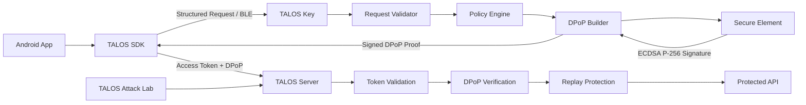

# TALOS

**Hardware-Bound DPoP Session Security Framework**

TALOS는 인증 이후 탈취된 Access Token의 재사용을 방지하기 위해, 세션 사용 권한을
독립된 하드웨어 키에 결합하는 세션 보안 프레임워크입니다.

일반적인 Bearer Token 구조에서는 토큰을 소유한 주체가 곧 해당 세션의 사용 권한을 가진
것으로 간주됩니다. TALOS는 OAuth DPoP의 Proof-of-Possession 구조를 기반으로 Access
Token과 암호학적 Key Ownership을 결합하고, Proof Key를 모바일 애플리케이션과 분리된
Embedded Secure Element에 저장합니다.

외부 임베디드 인증기인 **TALOS Key**는 단순히 전달받은 데이터를 서명하지 않습니다.
HTTP Method, URI, Access Token Hash, Nonce, Timestamp와 요청의 위험도를 직접 검증한
뒤에만 DPoP Proof를 생성하며, 고위험 API에는 물리적 사용자 승인을 추가로 요구합니다.

> **Token possession alone should not imply session ownership.**

---

## Motivation

MFA, Passkey, 생체인증과 같은 기술은 로그인 시점의 사용자 인증을 크게 강화했습니다.
그러나 인증 이후 발급된 Access Token이 탈취된다면 상황이 달라집니다.

```text
User Login
   ↓
MFA / Passkey
   ↓
Access Token
   ↓
Token Theft
   ↓
Attacker
   ↓
Authenticated API Request
```

Bearer Token은 기본적으로 **토큰의 소유 자체를 권한의 근거로 사용**합니다.
따라서 본 프로젝트는 다음 질문에서 출발합니다.

> 로그인에 성공한 사용자를 확인하는 것과, 현재 세션을 사용하는 주체가 원래 인증된
> 장치인지 확인하는 것은 같은 문제인가?

TALOS는 이를 서로 다른 문제로 정의합니다. 로그인 이후에도 클라이언트는 **해당 세션에
결합된 Private Key의 소유권을 지속적으로 증명**해야 합니다.

---

## Core Idea

기존 Bearer 방식은 다음과 같습니다.

```text
Access Token
     ↓
API Access
```

DPoP를 적용하면 다음 조건이 추가됩니다.

```text
Access Token
     +
Proof Key Ownership
     ↓
API Access
```

TALOS에서는 Proof Key를 모바일 환경에서 한 번 더 분리합니다.

```text
Android
└── Access Token

TALOS Key
└── Hardware-Protected Private Key
```

최종 요청은 두 보안 경계를 모두 통과해야 합니다.

```text
Access Token
      +
TALOS Key Approval
      +
Hardware-Bound DPoP Proof
      ↓
Protected API
```

---

## Why External Hardware?

Android Keystore, TEE, StrongBox와 같은 Hardware-backed Key Storage는 Private Key의
추출을 어렵게 만듭니다. 그러나 TALOS는 **Key Secrecy와 Key Usage Authorization을
별개의 문제**로 봅니다.

모바일 애플리케이션 계층이 침해된 상황에서는 Private Key를 직접 추출하지 못하더라도,
정상 애플리케이션처럼 서명 기능을 호출하려는 시도가 가능합니다.

TALOS는 다음과 같이 보안 경계를 분리합니다.

```text
┌──────────────────────┐
│ Android              │
│                      │
│ Access Token         │
│ Application Logic     │
└──────────┬───────────┘
           │ BLE
           ▼
┌──────────────────────┐
│ TALOS Key            │
│                      │
│ Request Validator    │
│ Policy Engine        │
│ DPoP Builder         │
│ User Presence        │
│       │              │
│ Secure Element       │
│ Private Key          │
└──────────────────────┘
```

따라서 모바일 클라이언트가 Access Token을 가지고 있다는 사실만으로는 세션 사용 권한이
완성되지 않습니다.

---

## Architecture



TALOS는 크게 네 부분으로 구성됩니다.

### TALOS SDK

Android 애플리케이션에서 세션과 DPoP 요청을 관리합니다.

- Access Token 관리
- HTTP Request Interception
- Server Nonce 처리
- TALOS Key 연결 관리
- DPoP Proof 요청
- Security Event 처리

### TALOS Key

ESP32-S3와 Secure Element를 기반으로 하는 독립 임베디드 인증기입니다.

- Device Identity 관리
- BLE 통신
- 요청 구조 검증
- Endpoint Risk Classification
- DPoP Payload 생성
- Secure Element 기반 ECDSA Signing
- Physical User Presence 검증
- Default Deny Policy

### TALOS Server

Access Token과 DPoP Proof를 검증합니다. 서버에서는 최소한 다음 항목을 검증합니다.

```text
Access Token Signature
Token Expiration
cnf.jkt
DPoP Signature
ath
htm
htu
jti
iat
nonce
```

### TALOS Attack Lab

인증 구조에 대한 공격을 자동화하고 보안성과 성능을 평가하는 실험 도구입니다.

---

## DPoP Interpretation

TALOS는 DPoP를 단순히 라이브러리 수준에서 적용하지 않고, 각 Claim이 어떤 공격을
제한하는지를 기준으로 구현합니다.

### `ath`

현재 Access Token의 SHA-256 Hash를 Proof에 결합합니다.

```text
DPoP Proof A
        +
Access Token B
→ ath mismatch
```

이를 통해 다른 Access Token에 기존 Proof를 붙이는 Token Substitution을 제한합니다.

### `htm`

DPoP Proof를 특정 HTTP Method에 결합합니다.

```text
GET Proof
   ↓
POST Request
→ Reject
```

### `htu`

Proof를 특정 HTTP URI에 결합합니다.

```text
Proof
/api/profile
        ↓ reuse
/api/transfer
→ Reject
```

### `jti`

각 Proof에 고유 식별자를 생성합니다. 이미 사용된 `jti`는 Replay Cache에서 차단합니다.

### `cnf.jkt`

Access Token 자체를 특정 DPoP Public Key에 결합합니다. 공격자가 Token을 탈취하고
자신의 Key Pair를 생성하더라도, Token에 저장된 Key Thumbprint와 일치하지 않습니다.

---

## Preventing Blind Signing

TALOS Key는 Raw Signing Oracle로 동작하지 않습니다. 다음과 같은 구조는 사용하지
않습니다.

```text
Android
   ↓
Arbitrary Hash
   ↓
TALOS Key
   ↓
Sign Anything
```

대신 Android는 구조화된 Request Context만 전달합니다.

```text
HTTP Method
URI
Token Hash
Nonce
Timestamp
Request ID
```

TALOS Key는 요청을 직접 검증한 뒤 내부에서 Proof를 생성합니다.

```text
Structured Request
       ↓
Parsing
       ↓
Validation
       ↓
Policy Evaluation
       ↓
DPoP Construction
       ↓
Secure Element Signing
```

이를 통해 TALOS Key를 **Request-Aware Policy Enforcement Point**로 사용합니다.

---

## Physical User Presence

모든 API에서 물리적 승인을 요구하면 보안성은 증가하지만 사용성이 크게 저하됩니다.
따라서 TALOS는 요청을 위험도에 따라 구분합니다.

```text
LOW
GET /api/profile
GET /api/history
→ Automatic Approval
```

```text
MEDIUM
POST /api/settings
→ Policy Evaluation
```

```text
HIGH
POST /api/transfer
POST /api/credential/change
→ Physical Approval Required
```

고위험 요청이 발생하면 TALOS Key가 사용자 승인을 기다립니다.

```text
High-Risk Request
        ↓
TALOS Key
        ↓
Approval Required
        ↓
Physical Button
    ┌─────────┴─────────┐
 Approved             Timeout
    ↓                    ↓
 Sign                 Reject
```

따라서 악성 모바일 클라이언트가 정상 TALOS Key와 연결되어 있더라도, 사용자 승인 없이
고위험 작업을 수행하는 것을 제한합니다.

---

## Security Models

TALOS에서는 다음 네 구조를 동일한 환경에서 비교합니다.

| Model | Authentication Structure                       |
| ----- | ---------------------------------------------- |
| S0    | Bearer Token                                   |
| S1    | Software DPoP                                  |
| S2    | Android Hardware-backed DPoP                   |
| S3    | TALOS Key + Secure Element + Physical Presence |

보안 계층은 다음과 같이 증가합니다.

```text
S0   Token Possession
     ↓
S1   Token + Software Key Possession
     ↓
S2   Token + Hardware-Protected Key
     ↓
S3   Token
     + Independent Hardware Boundary
     + Request Policy
     + Physical User Presence
```

---

## Attack Scenarios

TALOS Attack Lab은 다음 공격을 대상으로 합니다.

- Token Replay
- Cross-Device Token Replay
- Cross-Key Attack
- DPoP Proof Replay
- URI Substitution
- HTTP Method Substitution
- Token Substitution
- Stale Proof Replay
- Unauthorized High-Risk API Request

예를 들어 Cross-Key Attack은 다음과 같습니다.

```text
Stolen Access Token
        +
Attacker's Private Key
        ↓
DPoP Proof
        ↓
Server
Token cnf.jkt
       ≠
Proof Key Thumbprint
→ REJECT
```

---

## Prototype Evaluation

프로토타입 환경에서 Token Replay 공격 50회와, 사용자 승인 없이 수행한 고위험 요청
30회를 대상으로 공격 시나리오를 구성했습니다.

```text
Token Replay
50 / 50 blocked

Unauthorized High-Risk Request
30 / 30 blocked
```

외부 임베디드 인증기를 사용하면서 발생한 추가 End-to-End Request Latency는 중앙값
**143 ms**로 측정했습니다.

TALOS는 공격 차단률만을 목표로 하지 않습니다. 독립 하드웨어 보안 경계를 추가하면서
발생하는 통신 및 암호 연산 비용을 함께 측정하여, 다음 관계를 분석하는 것을 목표로
합니다.

```text
Security
   ↑
   │            TALOS
   │
   │
   └──────────────→ Overhead
```

> 모든 수치는 실제 실행 결과에서만 생성합니다. 성능 수치는 대조군(S0–S3)과 동일한
> 환경에서 반복 측정하며, 목표치는 별도로 `TARGET`으로 표기합니다.

---

## Hardware

TALOS Key의 기본 하드웨어 구성은 다음과 같습니다.

```text
ESP32-S3
+
Secure Element
+
Push Button
+
Status LED
+
BLE
```

Secure Element 내부에서 P-256 Private Key를 관리하며, Private Key Raw Data는 Android
또는 MCU에 전달하지 않습니다.

```text
Private Key
Secure Element
     │
     X Export
     │
Signing Only
```

---

## Technology Stack

### Mobile
- Kotlin
- Jetpack Compose
- OkHttp
- Android Keystore

### Embedded
- ESP32-S3
- ESP-IDF
- C / C++
- BLE GATT
- Secure Element
- CryptoAuthLib
- ECDSA P-256
- SHA-256

### Backend
- Python
- FastAPI
- JWT
- SQLite / PostgreSQL

### Security Testing
- Python
- Pytest
- HTTPX
- Automated Attack Runner

---

## Repository Structure

```text
talos/
│
├── android/
│   ├── talos-sdk/
│   └── demo-app/
│
├── embedded/
│   ├── firmware/
│   └── hardware/
│
├── server/
│   ├── app/
│   └── tests/
│
├── attack-lab/
│
├── experiments/
│   ├── runners/
│   ├── raw/
│   ├── results/
│   └── plots/
│
└── docs/
    ├── architecture.md
    ├── threat-model.md
    ├── protocol.md
    ├── embedded-security.md
    └── experiment-design.md
```

---

## Research Questions

TALOS는 다음 연구 질문에 답하는 것을 목표로 합니다.

**RQ1.** Device-Bound Proof-of-Possession은 탈취된 Access Token의 Cross-Device
Replay를 어느 수준까지 제한할 수 있는가?

**RQ2.** Hardware-backed DPoP 적용에 따른 인증 지연과 연산, 통신 오버헤드는 어느
정도인가?

**RQ3.** Access Token과 Proof Key를 독립된 보안 경계에 배치하면, Mobile Client
Compromise 상황에서 추가적인 보안성을 확보할 수 있는가?

**RQ4.** Request-Aware Embedded Authenticator와 Physical User Presence를 적용했을 때,
보안성과 사용성 사이에는 어떤 Trade-off가 발생하는가?

---

## Threat Model

공격자는 다음 능력을 가질 수 있다고 가정합니다.

- Access Token 탈취
- 정상 DPoP Proof 획득
- HTTP Request Replay
- 자신의 Key Pair 생성
- URI, Method 변경
- Token과 Proof 조합 변경
- 모바일 애플리케이션 계층에서 임의 API 요청 시도

다음 공격은 본 연구 범위에서 제외합니다.

- Secure Element에 대한 Invasive Physical Attack
- 서버 Signing Key 탈취
- TLS 자체의 암호학적 파괴
- 사용자 본인이 악성 요청을 직접 승인하는 사회공학 공격

TALOS는 모든 세션 공격을 해결하는 범용 보안 체계가 아니라, **Token Replay와
Client-side Session Ownership 문제를 특정 위협 모델 안에서 다루는 연구용
프레임워크**입니다.

---

## Project Name

**TALOS**라는 이름은 그리스 신화에서 크레타 섬을 지키던 청동 수호자 **Talos**에서
가져왔습니다. TALOS Key 역시 애플리케이션 외부의 독립된 하드웨어 경계에서 세션 요청을
검증하고 보호한다는 의미를 담고 있습니다.

---

## License

See [LICENSE](LICENSE).
